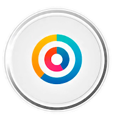

 

**I design, build, ship and maintain my own Android apps** 📟
 
Flutter + Firebase most days · Kotlin & Compose when it has to be native

 

---

### 📱 Shipped & maintained

<table>
  <tr>
    <td align="center" width="25%">
      
       <b>Unlock Stats</b>
       Unlock tracking, charts & a retro-terminal theme
       <code>Kotlin</code>
    </td>
    <td align="center" width="25%">
      
       <b>Device Sensors</b>
       Every sensor in your phone, live
       <code>Flutter</code>
    </td>
    <td align="center" width="25%">
      
       <b>MemoTest for Devs</b>
       Memory game, 40 levels, 6 languages
       <code>Kotlin · Compose</code>
    </td>
    <td align="center" width="25%">
      
       <b>Click Blog</b>
       Offline-first reader for my blog
       <code>Flutter</code>
    </td>
  </tr>
</table>

🧩 Also on **WordPress.org**: [Protect WP Login](https://alebuo.click.com.ar/go/plugin) — HTTP Basic Auth in front of `wp-login.php`, so brute-force bots never reach WordPress.

👉 Screenshots and details: **[alebuo.click.com.ar](https://alebuo.click.com.ar/?utm_source=github&utm_medium=profile&utm_campaign=apps#apps)**

---

### 🎮 Take a break

---

### 🧰 Stack

  

Firestore · Firebase Auth · Crashlytics · Jetpack Compose · Room · Riverpod · REST APIs · Pandas

---

### 🔒 Where's the code?

Most of what I build lives in private repos — client work and products in progress.
The apps above are the public face of it. Curious about any of it? **[Say hi on LinkedIn](https://alebuo.click.com.ar/go/linkedin)**.

 
📰 I also run <a href="https://alebuo.click.com.ar/go/blog">blog.click.com.ar</a>, a small Spanish-language tech blog.

